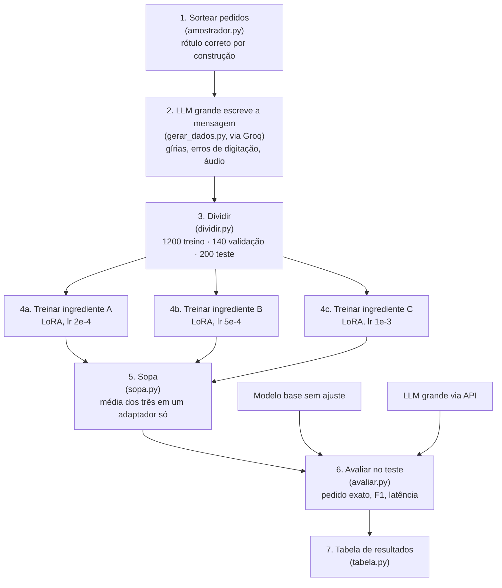
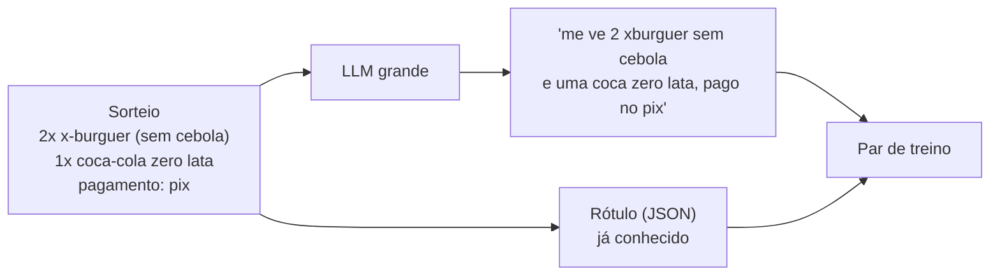
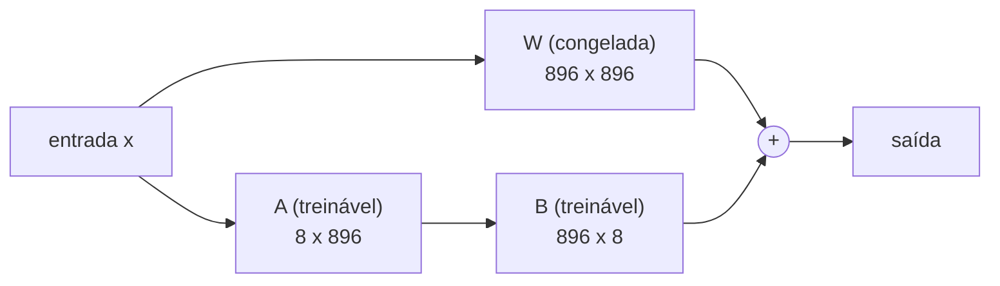
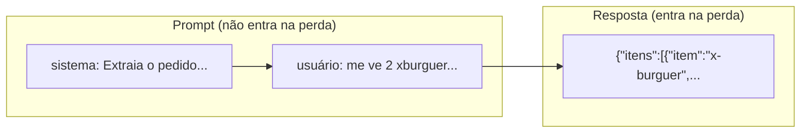
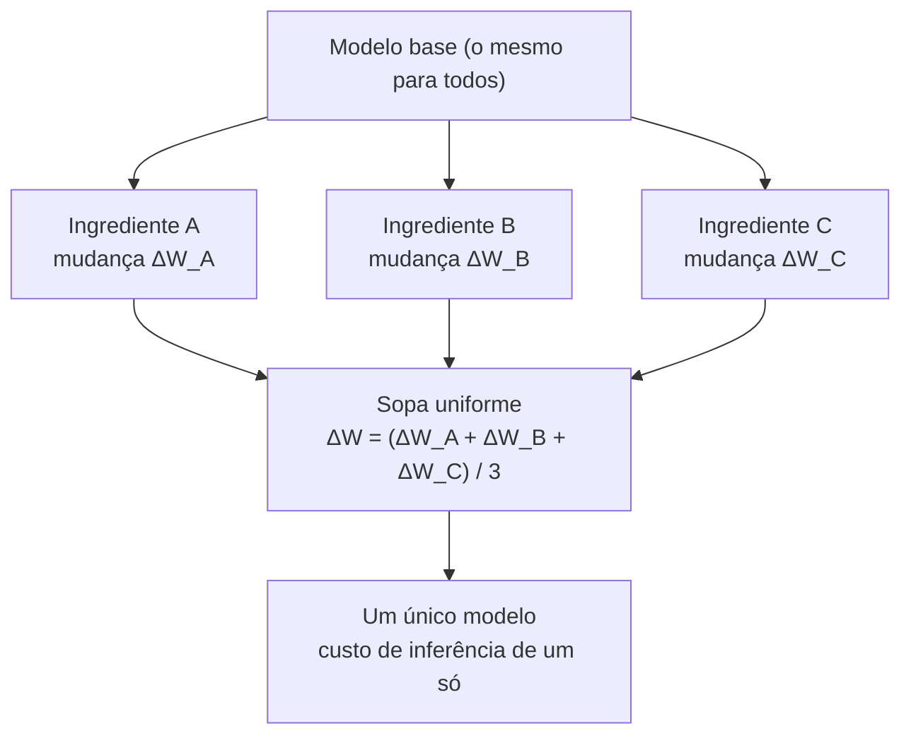
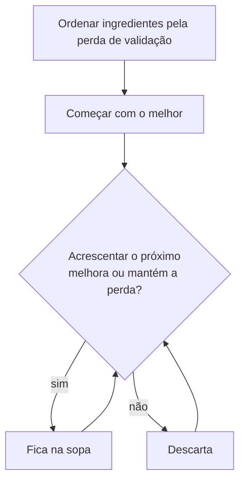

# Como o projeto funciona, passo a passo

Este documento explica o caminho completo, da criação dos dados até o modelo final.
O GitHub desenha os diagramas abaixo automaticamente.

## Visão geral

## 1. De onde vêm os dados

O problema de pedir a um LLM que invente exemplos *e* rótulos é que ele erra os rótulos.
Aqui a ordem é invertida:

O computador sorteia o pedido, então o rótulo já está certo. O LLM grande só faz o que
sabe fazer bem: escrever como uma pessoa escreveria.

## 2. O que é LoRA

Um modelo de linguagem é uma pilha de matrizes grandes de números (os pesos).
Ajustar todas elas exige muita memória. O LoRA congela o modelo e treina, para cada
matriz `W`, duas matrizes pequenas `A` e `B`:

O efeito é `W + B·A`. Neste projeto isso significa treinar **0,22% dos parâmetros**
(1,1 milhão de 495 milhões), o que cabe em uma CPU comum.

## 3. O que o modelo vê no treino

O modelo tenta prever cada token da resposta. O erro dessa previsão é a *perda*, e o
treino ajusta `A` e `B` para diminuí-la. Os tokens do prompt são mascarados: o modelo
não é cobrado por adivinhar a mensagem do cliente.

## 4. O que é a sopa (model soup)

O jeito tradicional é treinar várias versões com hiperparâmetros diferentes e ficar
só com a melhor. A sopa aproveita todas: tira a **média dos pesos**.

Dois detalhes importam:

- **Por que funciona:** todos partem do mesmo modelo base, então terminam em regiões
  próximas do espaço de pesos, e a média entre eles continua sendo um bom modelo.
- **A armadilha com LoRA:** não se pode tirar a média de `A` e de `B` separadamente,
  porque `média(B)·média(A)` é diferente de `média(B·A)`. O `sopa.py` empilha as
  matrizes (`A` nas linhas, `B` nas colunas), o que dá a média exata e mantém o
  resultado como um adaptador pequeno. O teste `tests/test_sopa.py` prova as duas coisas.

A **sopa gulosa** é uma variação: ordena os ingredientes do melhor para o pior na
validação e só acrescenta um ingrediente se ele não piorar o resultado.

## 5. Como é medido

| Métrica | O que significa |
|---|---|
| Pedido exato | O pedido inteiro está certo: todos os itens, quantidades, observações e os quatro campos |
| F1 de itens | Acerto parcial: quantos itens (com quantidade e observações) batem |
| JSON válido | A saída pôde ser lida e segue o esquema |
| Tokens de prompt | Quanto texto o modelo precisa receber por pedido (custo) |

O conjunto de teste (200 pedidos) nunca é usado no treino nem na escolha da sopa;
a sopa gulosa decide com o conjunto de validação.

## 6. O que aconteceu neste experimento

Os resultados estão no [README](../README.md#resultados). Em resumo: o ajuste levou o
modelo de 0% para 85% de pedidos exatos, e a sopa não superou o melhor ingrediente
porque os três ficaram com qualidade muito desigual após uma única época de treino.
